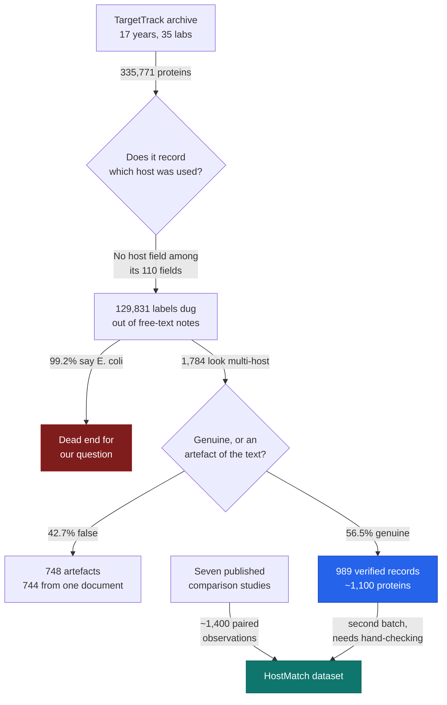

# HostMatch — project story

The durable record. Newest checkpoint at the top. Each entry is written to be
readable without the conversation it came from.

## Checkpoints
1. **2026-10-17 — The big database does not have what we needed** (below)

---

# 2026-10-17 — The big database does not have what we needed

## 1. Where we are

We checked whether a large free database could supply our data. It cannot, for a
specific and now-proven reason — but a small usable piece fell out of it.

## 2. What this project is for

When a scientist wants to manufacture a protein, they must first choose what to
make it in: bacteria, yeast, insect cells, mammalian cells, or a cell-free
chemical mixture. Pick wrong and you lose months and money.

Every prediction tool in the published literature answers only one question:
*"will E. coli work?"* We checked seven of them — SoluProt, EPSOL, ESPRESSO,
RPOLP, RP3Net, TagSolver and others — and every one is E. coli only. The
literature says so about itself: *"they are all optimized for the expression host
Escherichia coli."*

**HostMatch answers the other question: which host should I use?** Winning looks
like two things — a dataset nobody has assembled before, and a tool that reads a
protein sequence and ranks the hosts likely to produce it.

## 3. Why this step

Our dataset was thin: roughly 1,400 usable observations, hand-copied out of seven
published studies. That is small for training anything.

TargetTrack looked like it might fix that. It is the archive of a 15-year US
government programme — 35 laboratories, 350,000 proteins, every experiment
logged, released free under an open licence. If it recorded which host each
protein was made in, our dataset grows by a hundredfold and the project changes
shape completely.

If we had skipped this check and started hand-curating, we would have spent weeks
building something a free archive might already contain — or, worse, discovered
the gap later and had to redo the design.

## 4. What we actually did

Three things.

**We put the project under version control (*git*) and published it to GitHub.**
Every file, every change, timestamped and recoverable. This matters for a reason
beyond tidiness, covered in Decisions below.

**We ran an automated worker (*agent*) to interrogate TargetTrack.** It
downloaded the 833 MB archive, confirmed it arrived intact (*MD5 verified*), read
the archive's own rulebook describing what fields exist (*schema*), then streamed
the whole 350,000-record file counting everything.

**We got a clear negative, plus one exception worth keeping.**

## 5. How it works

Think of TargetTrack as **seventeen years of lab notebooks from thirty-five
different bakeries.**

| In the analogy | In reality |
|---|---|
| The recipe | The protein's genetic sequence |
| **The oven** | **The host organism it was grown in** |
| How the bake turned out | Did it express? Dissolve? Purify? Fail? |
| The notebooks | The TargetTrack archive |

We hoped the notebooks recorded which oven each bake used. They record the recipe
in detail, the ingredients in detail, and the outcome in detail — but **almost
never the oven**, because nearly every bakery used the same one.

That is not a metaphor stretched for effect. The archive's rulebook declares 110
different fields, and **not one of them is the host.** Host appears only where
someone happened to mention it in free-form notes.

And where they did write it down in a structured way — a `host:` label some labs
typed into their notes — here is the decisive number:

> **That label appears 86,090 times and takes exactly one value every time:
> *Escherichia coli*.**

Of the 335,771 proteins in the file, 129,831 (38.7%) yield any host at all once
we dig through the prose. **128,849 of those 129,831 — 99.2% — are E. coli.**
Everything that is not E. coli totals about 2,900 proteins: **0.86% of the
archive.** There is effectively no yeast data and no plant or algal data at all.

**The exception.** A few laboratories working on difficult membrane proteins
genuinely did run the same protein through several ovens. Those records are
exactly what we need. After verification there are **989 of them**, covering
roughly 1,100–1,200 distinct proteins.

And the signal in them is real — the same proteins behave differently by host:

| Host | work stopped | soluble | purified |
|---|---:|---:|---:|
| E. coli | 2,117 | 722 | 198 |
| insect | 1,037 | 571 | 308 |
| cell-free | 4 | 69 | 16 |

Insect cells reach "soluble" and "purified" far more often than E. coli on this
set. Cell-free almost never records an outright failure.

## 6. The diagram

*Blue is what we just produced. Teal is the goal. Dark red is the path that
closed.*

## 7. What you have now

**Working, in the repository:**

- `reports/01-targettrack-inventory.md` — 570 lines. Open it and you see the full
  interrogation of TargetTrack: every field it contains, every count, and the
  reasoning behind the 989 figure. This is the evidence for the decision below.
- `scripts/targettrack.py` — 769 lines. The program that fetched and counted.
  Re-runnable; the commands are listed at the end of the report.
- `README.md` — one page saying what the project is and the rule that no data is
  touched before the protocol is written.
- `.gitignore` — the list of things never to store in the repository, so the
  833 MB archive can never be committed by accident.

**Not done yet, and worth being clear about:**

- **The 989 records are not in the repository.** The worker produced them in a
  temporary workspace that no longer exists. We have the program that makes them;
  we do not have the output. It needs re-running.
- **Nothing has been curated from the seven papers.** That work has not started.
- **No dataset exists. No model exists.** The project is at the planning stage.
- `protocol/`, `data/`, `notebooks/` are empty folders waiting to be filled.

## 8. Decisions made, and why

| We chose | We chose against | Why |
|---|---|---|
| Keep the hand-curated literature corpus as the primary data | Rebuilding the project on TargetTrack | TargetTrack has no host field. 99.2% of what can be dug out is E. coli. |
| Treat the 989 records as a **separate** batch | Mixing them into the main dataset | They are membrane-protein-heavy and come from a handful of labs. Pooling them naively would bias the result. |
| Named the project **HostMatch** | Polyglot, HostSeek, ChassisPick, Terroir | "Polyglot" and "host-seeking" already mean other things in software and biology. HostMatch matches the existing PhageMatch-PK naming. |
| Release the dataset **before** building the model | Model first | The dataset stands alone as a contribution and is citable even if the model disappoints. |
| Multi-host expression prediction | Klebsiella phage enzymes; algal cell-free systems; auditing the vaccine-design literature | The first was shaped by the CV rather than the field's gaps. The second turned out to be already published this year. The third was auditing rather than building. |
| Version control from day one | Working in a plain folder | Taken from the Anthropic preprint: they commit every plan, result and script, which is what lets you show later that decisions were not tuned to the answer. |

## 9. Jargon decoder

| Term | Plain meaning |
|---|---|
| **host / chassis** | The living thing (or chemical mixture) you grow your protein in |
| **cell-free** | Making protein in a tube of extracted cell machinery, with no living cells |
| **expression** | Getting a cell to actually manufacture your protein |
| **soluble** | The protein dissolved properly instead of clumping into a useless lump |
| **schema** | The rulebook saying what fields a database is allowed to contain |
| **git / repository** | A system recording every version of every file, so nothing is lost and every change is dated |
| **agent** | An automated worker given a written brief that runs on its own |
| **MD5** | A fingerprint used to confirm a downloaded file arrived intact |
| **regex** | Pattern-matching over text — here, hunting for host names inside prose |
| **paired observation** | The same protein tried in two or more hosts, so the hosts can be compared fairly |
| **stratum** | A subgroup kept separate because it differs systematically from the rest |

## 10. What is next, and what could go wrong

**Next:** write the protocol — the decisions frozen in writing *before* any data
is touched, so nobody can later say the rules were adjusted to suit the answer.
Then re-run the extraction of the 989 records. Then begin curating the seven
papers by hand.

**Honest risks:**

- **The dataset may still be too small.** ~1,400 plus ~1,000 is roughly 2,400
  paired observations. Enough to try, not enough to be confident.
- **The 989 host labels were found by pattern-matching prose, not read from a
  proper field.** When the worker checked its own first answer, **42.7% of the
  1,784 it initially found were wrong** — and 744 of those traced to a single
  document whose introduction *mentions* E. coli while describing a different
  method. Every one of the 989 still needs a human to confirm it.
- **The two batches may not combine.** The published studies and the TargetTrack
  records describe outcomes in different vocabularies. If those cannot be mapped
  onto one scale honestly, they stay separate and the usable total shrinks.
- **A process error, reported as such:** the automated worker was launched
  expecting it to run on cloud credits. It did not — it ran locally and consumed
  the regular session allowance, while the $100 of cloud credit went untouched.
  The work itself is sound; it was paid for from the wrong budget because the
  setting was assumed to have taken effect rather than verified.
