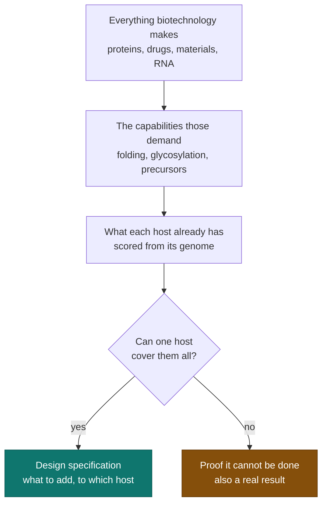
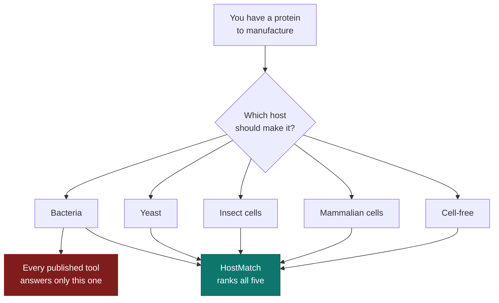
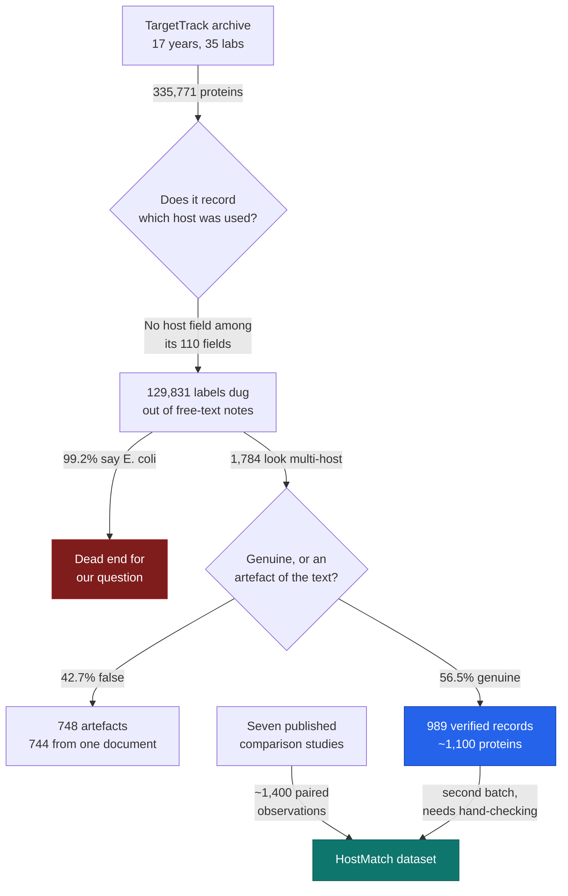

# HostMatch — project story

The durable record. Newest checkpoint at the top. Each entry is written to be
readable without the conversation it came from.

## Checkpoints
1. **2026-10-20 — The checklist exists: 37 capabilities** (below)
2. **2026-10-20 — The target is a universal chassis**
3. **2026-10-20 — How we got here, and what HostMatch is**
4. **2026-10-17 — The big database does not have what we needed**

---

# 2026-10-20 — The checklist exists: 37 capabilities

Short entry. The record itself is the file, not this summary.

**What was built:** [`protocol/capability-set-v1.md`](../protocol/capability-set-v1.md)
and [`protocol/capabilities-v1.tsv`](../protocol/capabilities-v1.tsv).

**37 capabilities in 7 categories** — 15 binary (you have it or you don't),
22 graded (a matter of how much): genetic expression (6), protein maturation (7),
catalysis and cofactors (5), precursor supply (5), compartments and membranes (4),
tolerance and robustness (4), process and deployment (6).

**The rule used to decide what goes on the list:** a capability is included only
if the literature names it as something that *blocks production when absent*. Not
"would be nice." Every entry carries the quote that put it there.

**The surprise:** tolerance — surviving your own product — turns out to be a
first-class blocker, not an afterthought. Recent work repeatedly finds it is the
binding constraint rather than the pathway: *"Genome-scale overexpression
screening identifies product tolerance and efflux transport as key determinants
of high-level production."* It had not been on my mental list before the search.

**Not done, and listed in the file itself:** no host has been scored against any
of the 37. There is no weighting. **There is no conflict map** — nobody has
checked whether any two capabilities are mutually exclusive, and if they are,
universality is impossible on physical grounds. That is the most important
unanswered question in the project. The evidence quotes are from abstracts, not
full papers.

**Decision recorded:** inclusion requires documented blocking evidence, not
plausibility. This keeps the list defensible and stops it growing without limit.

---

# 2026-10-20 — The target is a universal chassis

## 1. Where we are

The owner has reset the goal. We are no longer building a tool that *chooses
between* existing hosts. We are working toward **one host that can make
anything** — and the first job is to define what that sentence actually means.

## 2. What changed, and why I was wrong

HostMatch — predicting which of five existing hosts suits a given protein — was
a narrowing of the owner's original idea, and I made it without flagging that I
had narrowed it. The original idea was to **build or design a host that produces
any product in biotechnology.** Choosing between hosts and building a better host
are different projects. The owner was right to stop it.

## 3. What the field calls this

It has a name: **universal chassis**, also "plug-and-play chassis" or
"super-chassis". It is a live, funded ambition. Nobody has one.

| Built already | What it is |
|---|---|
| **JCVI-syn3.0** | A bacterium stripped to 473 genes — the smallest self-replicating cell ever made. Its creators call it *"a versatile platform."* Built by **John Glass, who teaches HTGAA Week 12.** |
| **Streptomyces super-chassis** (2024) | *"a versatile plug-and-play super-chassis and a universal pipeline"* — for secondary metabolites |
| **Pichia plug-and-play factory** (2025) | Universal — for terpenoids |
| **PLUG-IN photosynthetic chassis** (2026) | Universal — for photosynthetic products |

**The pattern nobody states outright:** every "universal" chassis actually built
is universal *within one product class*. Universal-for-everything has not been
attempted publicly. That is either a real biological limit or an unclaimed
ambition, and establishing which is itself a result.

## 4. Why no universal host exists — and the barrier that is falling

**Post-translational modifications.** Bacteria cannot attach sugar chains to
proteins and handle disulfide bonds poorly. This is the main reason complex
proteins need insect or mammalian cells.

**But this is being engineered away, host by host:**

- *"Construction of an Escherichia coli chassis for efficient biosynthesis of
  human-like N-linked glycoproteins"* (2024) — a bacterium making human-style
  sugar chains
- *"Humanization of Yeasts for Glycan-Type End-Products"* (2022)
- Human biantennary glycans engineered into *Komagataella phaffii* (2026)

**The growth-versus-production conflict.** *"The inherent conflict between
cellular growth and product synthesis, arising from limited resource allocation
and metabolic burden, fundamentally constrains the performance of microbial
chassis"* (2026). A cell making your product is a cell not making more of itself.
No clean solution exists.

**Parts do not port between hosts**, and **the genetic code is fixed** — though
engineered tRNA synthetases are expanding it.

## 5. The reframe that makes this workable

"Produce everything" cannot be worked on. "Cover every capability" can.

A universal chassis does not need to make every molecule. It needs every
**ability** that molecules require. Those are enumerable:

| Product class | Capabilities it demands |
|---|---|
| Proteins | folding, disulfide bonds, glycosylation, secretion, protease balance |
| Small molecules | precursor supply, cofactor regeneration, membrane enzymes, tolerance to toxic products |
| Nucleic acids | polymerases, capping, modified nucleotides |
| Materials | polymerisation, assembly, export |

**Universality = covering the capability set.** That makes the goal countable,
scoreable, and testable — which "everything" never could be.

## 6. The diagram

*Both endings are publishable. That is deliberate — the project has a good
failure mode.*

## 7. The honest scale problem

JCVI took roughly twenty years and tens of millions of dollars to build one
minimal cell — and that cell makes nothing useful yet. It is a research platform.

**Building a universal chassis is a multi-decade, multi-laboratory, wet-lab
programme.** The owner has a laptop and no reagents. This is not a reason to drop
the goal. It is a reason to be exact about what the first contribution is.

## 8. The first contribution

**A capability atlas.** For every host and every capability: what it has, what it
lacks, who has engineered the missing piece in, and how well that worked.

Nobody has assembled this. The field knows the barriers in words — "bacteria
can't glycosylate", "yeast glycans are wrong" — but there is no computable map.

It is dry-lab, it is buildable, and it is **the design document for the chassis
itself**: you cannot build a universal host without first knowing the complete
list of what you would have to add.

## 9. Decisions made, and why

| We chose | We chose against | Why |
|---|---|---|
| Universal chassis as the goal | HostMatch (choosing between existing hosts) | HostMatch was a narrowing of the owner's idea, made without flagging it. The owner reset it. |
| "Everything" rather than "everything within a product class" | The achievable version | Owner's explicit choice. Higher risk of failure, and nobody has attempted it publicly. |
| Define universality as a **capability set** | A product list | A product list is infinite and untestable. A capability set is countable and scoreable. |
| Capability atlas as the first build | Going straight at the chassis | The wet-lab work needs a laboratory. The atlas does not, and the chassis cannot be designed without it. |

## 10. What could go wrong

- **"Everything" may be physically impossible.** Products need conflicting
  conditions — some anaerobic, some aerobic; some toxic to the host that must
  make them. If the capability map shows irreconcilable conflicts, universality
  is disproved. That is a genuine result, and the project is designed so that
  outcome still counts as success.
- **The atlas is a large curation job** and we have just learned from TargetTrack
  how often the data you need is simply not recorded.
- **It is not an HTGAA project.** This has moved decisively toward the owner's own
  research. A separate, smaller project will be needed for the course in January
  if the course is still wanted.

---

# 2026-10-20 — How we got here, and what HostMatch is

## 1. Where we are

We have a clear question, a repository, and no data yet. The next move is a small
test designed to kill the idea cheaply if it deserves killing.

## 2. What this project is, in one page

A scientist has a protein they want to manufacture — insulin, an antibody, an
industrial enzyme, a vaccine component. They cannot simply make it. They have to
persuade something alive to make it for them.

They get roughly five choices:

| Choice | What it is like |
|---|---|
| **Bacteria** (*E. coli*) | Cheap and fast. Fails often on complicated proteins. |
| **Yeast** | Slower, handles more complexity. |
| **Insect cells** | More capable, more expensive. |
| **Mammalian cells** | Handles almost anything. Slow and costly. |
| **Cell-free** | A tube of extracted cell machinery. Nothing alive. |

Pick wrong and you lose months and money. In practice almost nobody chooses —
they try bacteria first, because that is what everyone does, and deal with
failure afterwards.

There are software tools meant to help. **Every single published one answers only
one question: "will bacteria work?"** We checked seven of them. The literature
says so about itself: *"they are all optimized for the expression host
Escherichia coli."*

**Nobody has built the tool that answers the actual question: which one should I
use?**

## 3. Why nobody has built it

Because of what you would need to learn from.

To learn which host suits which protein, you need records of **the same protein
tried in several hosts**. Almost nobody publishes that. A lab tries one host; it
works or it does not; they publish the one that worked. The failures and the
alternatives go unrecorded.

So the project is really this: **find the rare cases where someone did try the
same protein in several hosts, gather them into one place for the first time,
and see whether a pattern comes out.**

That gathering is the hard part and the real contribution. The model is what you
build on top to show the gathering was worth doing.

## 4. How we arrived at this idea

This did not start here. It started with wanting a project for HTGAA, an MIT
synthetic biology course. Four ideas were considered seriously and dropped. The
reasons matter, because each one taught us the test the next idea had to pass.

| Idea | What it was | Why it was dropped |
|---|---|---|
| **Klebsiella phage enzymes** | Design the enzymes needed to manufacture a vaccine against bacterial types common in Pakistan | It was shaped by what was already on the CV rather than by a gap in the field. A 2026 paper in *PLoS Medicine* had also partly occupied the ground. |
| **Algal cell-free systems** | Make proteins in a tube using machinery extracted from algae | The platform does not exist. Nobody has built one. Building it is one to three years of laboratory work. |
| **Cold-chain-free biologics** | Medicines that survive without refrigeration | A 2026 paper in *ACS Synthetic Biology* had already done the central piece — using tardigrade proteins to store cell-free systems. |
| **Auditing vaccine-design papers** | Checking whether thousands of computational vaccine papers hold up | A real and open gap, but it is auditing rather than building, and that was not the work wanted. |

Then the idea came from the owner, not from me: *an AI model of host organisms
that could produce anything.* Tested against the literature, it turned out to
name a gap the field states about itself. That became HostMatch.

**The lesson that survived all four rejections:** a gap you *measure* is durable;
a gap you *infer from not finding a paper* is fragile. Three of the four above
died because the gap was inferred and turned out to be filled.

## 5. Where the data will come from

Two sources, both small, neither extracted yet.

- **Seven published comparison studies** — roughly 1,400 paired observations.
  These are the careful ones: a single lab deliberately running the same set of
  proteins through several hosts and reporting all the results, failures
  included.
- **TargetTrack** — roughly 989 verified records, dug out of a 350,000-protein
  government archive. Checked on 17 October; the archive turned out to be 99.2%
  bacteria, so only this small corner is usable, and every label still needs a
  human to confirm it.

Total: about **2,400 paired observations**. That is enough to attempt, not enough
to be confident. Stated plainly because it is the central risk.

## 6. The diagram

*Dark red is the limit of what exists today. Teal is what we are building, and it
does not exist yet.*

## 7. What is next

A **pilot built to fail fast**. Extract only the two freely available papers —
about 160 to 280 paired observations — and ask one question: once you account for
which protein it is, does the host still explain anything?

If protein difficulty explains everything and the host adds nothing, the tool has
nothing to say and we stop. Finding that out in two weeks instead of two months
is the entire purpose of running a pilot first.

## 8. Decisions made, and why

| We chose | We chose against | Why |
|---|---|---|
| A pilot on two free papers | Writing the full protocol first, then curating everything | The pilot tests the three riskiest assumptions at once. A protocol written in the abstract would be rewritten once real papers forced different decisions. |
| Test "does host matter at all" first | Testing extraction or sample size first | If the host effect is small relative to how hard the protein is, nothing downstream matters. |

## 9. Open question for the owner

**Is this still an HTGAA course project, or your own research?** It has drifted
toward the second. Keeping the course frame means the demonstration construct
becomes real work and the course's requirements shape the scope. Dropping it
means the dataset and model are the whole point, and a separate, simpler project
is needed for the course in January.

---

# 2026-10-17 — The big database does not have what we needed

## 1. Where we are

We checked whether a large free database could supply our data. It cannot, for a
specific and now-proven reason — but a small usable piece fell out of it.

## 2. What this project is for

When a scientist wants to manufacture a protein, they must first choose what to
make it in: bacteria, yeast, insect cells, mammalian cells, or a cell-free
chemical mixture. Pick wrong and you lose months and money.

Every prediction tool in the published literature answers only one question:
*"will E. coli work?"* We checked seven of them — SoluProt, EPSOL, ESPRESSO,
RPOLP, RP3Net, TagSolver and others — and every one is E. coli only. The
literature says so about itself: *"they are all optimized for the expression host
Escherichia coli."*

**HostMatch answers the other question: which host should I use?** Winning looks
like two things — a dataset nobody has assembled before, and a tool that reads a
protein sequence and ranks the hosts likely to produce it.

## 3. Why this step

Our dataset was thin: roughly 1,400 usable observations, hand-copied out of seven
published studies. That is small for training anything.

TargetTrack looked like it might fix that. It is the archive of a 15-year US
government programme — 35 laboratories, 350,000 proteins, every experiment
logged, released free under an open licence. If it recorded which host each
protein was made in, our dataset grows by a hundredfold and the project changes
shape completely.

If we had skipped this check and started hand-curating, we would have spent weeks
building something a free archive might already contain — or, worse, discovered
the gap later and had to redo the design.

## 4. What we actually did

Three things.

**We put the project under version control (*git*) and published it to GitHub.**
Every file, every change, timestamped and recoverable. This matters for a reason
beyond tidiness, covered in Decisions below.

**We ran an automated worker (*agent*) to interrogate TargetTrack.** It
downloaded the 833 MB archive, confirmed it arrived intact (*MD5 verified*), read
the archive's own rulebook describing what fields exist (*schema*), then streamed
the whole 350,000-record file counting everything.

**We got a clear negative, plus one exception worth keeping.**

## 5. How it works

Think of TargetTrack as **seventeen years of lab notebooks from thirty-five
different bakeries.**

| In the analogy | In reality |
|---|---|
| The recipe | The protein's genetic sequence |
| **The oven** | **The host organism it was grown in** |
| How the bake turned out | Did it express? Dissolve? Purify? Fail? |
| The notebooks | The TargetTrack archive |

We hoped the notebooks recorded which oven each bake used. They record the recipe
in detail, the ingredients in detail, and the outcome in detail — but **almost
never the oven**, because nearly every bakery used the same one.

That is not a metaphor stretched for effect. The archive's rulebook declares 110
different fields, and **not one of them is the host.** Host appears only where
someone happened to mention it in free-form notes.

And where they did write it down in a structured way — a `host:` label some labs
typed into their notes — here is the decisive number:

> **That label appears 86,090 times and takes exactly one value every time:
> *Escherichia coli*.**

Of the 335,771 proteins in the file, 129,831 (38.7%) yield any host at all once
we dig through the prose. **128,849 of those 129,831 — 99.2% — are E. coli.**
Everything that is not E. coli totals about 2,900 proteins: **0.86% of the
archive.** There is effectively no yeast data and no plant or algal data at all.

**The exception.** A few laboratories working on difficult membrane proteins
genuinely did run the same protein through several ovens. Those records are
exactly what we need. After verification there are **989 of them**, covering
roughly 1,100–1,200 distinct proteins.

And the signal in them is real — the same proteins behave differently by host:

| Host | work stopped | soluble | purified |
|---|---:|---:|---:|
| E. coli | 2,117 | 722 | 198 |
| insect | 1,037 | 571 | 308 |
| cell-free | 4 | 69 | 16 |

Insect cells reach "soluble" and "purified" far more often than E. coli on this
set. Cell-free almost never records an outright failure.

## 6. The diagram

*Blue is what we just produced. Teal is the goal. Dark red is the path that
closed.*

## 7. What you have now

**Working, in the repository:**

- `reports/01-targettrack-inventory.md` — 570 lines. Open it and you see the full
  interrogation of TargetTrack: every field it contains, every count, and the
  reasoning behind the 989 figure. This is the evidence for the decision below.
- `scripts/targettrack.py` — 769 lines. The program that fetched and counted.
  Re-runnable; the commands are listed at the end of the report.
- `README.md` — one page saying what the project is and the rule that no data is
  touched before the protocol is written.
- `.gitignore` — the list of things never to store in the repository, so the
  833 MB archive can never be committed by accident.

**Not done yet, and worth being clear about:**

- **The 989 records are not in the repository.** The worker produced them in a
  temporary workspace that no longer exists. We have the program that makes them;
  we do not have the output. It needs re-running.
- **Nothing has been curated from the seven papers.** That work has not started.
- **No dataset exists. No model exists.** The project is at the planning stage.
- `protocol/`, `data/`, `notebooks/` are empty folders waiting to be filled.

## 8. Decisions made, and why

| We chose | We chose against | Why |
|---|---|---|
| Keep the hand-curated literature corpus as the primary data | Rebuilding the project on TargetTrack | TargetTrack has no host field. 99.2% of what can be dug out is E. coli. |
| Treat the 989 records as a **separate** batch | Mixing them into the main dataset | They are membrane-protein-heavy and come from a handful of labs. Pooling them naively would bias the result. |
| Named the project **HostMatch** | Polyglot, HostSeek, ChassisPick, Terroir | "Polyglot" and "host-seeking" already mean other things in software and biology. HostMatch matches the existing PhageMatch-PK naming. |
| Release the dataset **before** building the model | Model first | The dataset stands alone as a contribution and is citable even if the model disappoints. |
| Multi-host expression prediction | Klebsiella phage enzymes; algal cell-free systems; auditing the vaccine-design literature | The first was shaped by the CV rather than the field's gaps. The second turned out to be already published this year. The third was auditing rather than building. |
| Version control from day one | Working in a plain folder | Taken from the Anthropic preprint: they commit every plan, result and script, which is what lets you show later that decisions were not tuned to the answer. |

## 9. Jargon decoder

| Term | Plain meaning |
|---|---|
| **host / chassis** | The living thing (or chemical mixture) you grow your protein in |
| **cell-free** | Making protein in a tube of extracted cell machinery, with no living cells |
| **expression** | Getting a cell to actually manufacture your protein |
| **soluble** | The protein dissolved properly instead of clumping into a useless lump |
| **schema** | The rulebook saying what fields a database is allowed to contain |
| **git / repository** | A system recording every version of every file, so nothing is lost and every change is dated |
| **agent** | An automated worker given a written brief that runs on its own |
| **MD5** | A fingerprint used to confirm a downloaded file arrived intact |
| **regex** | Pattern-matching over text — here, hunting for host names inside prose |
| **paired observation** | The same protein tried in two or more hosts, so the hosts can be compared fairly |
| **stratum** | A subgroup kept separate because it differs systematically from the rest |

## 10. What is next, and what could go wrong

**Next:** write the protocol — the decisions frozen in writing *before* any data
is touched, so nobody can later say the rules were adjusted to suit the answer.
Then re-run the extraction of the 989 records. Then begin curating the seven
papers by hand.

**Honest risks:**

- **The dataset may still be too small.** ~1,400 plus ~1,000 is roughly 2,400
  paired observations. Enough to try, not enough to be confident.
- **The 989 host labels were found by pattern-matching prose, not read from a
  proper field.** When the worker checked its own first answer, **42.7% of the
  1,784 it initially found were wrong** — and 744 of those traced to a single
  document whose introduction *mentions* E. coli while describing a different
  method. Every one of the 989 still needs a human to confirm it.
- **The two batches may not combine.** The published studies and the TargetTrack
  records describe outcomes in different vocabularies. If those cannot be mapped
  onto one scale honestly, they stay separate and the usable total shrinks.
- **A process error, reported as such:** the automated worker was launched
  expecting it to run on cloud credits. It did not — it ran locally and consumed
  the regular session allowance, while the $100 of cloud credit went untouched.
  The work itself is sound; it was paid for from the wrong budget because the
  setting was assumed to have taken effect rather than verified.
